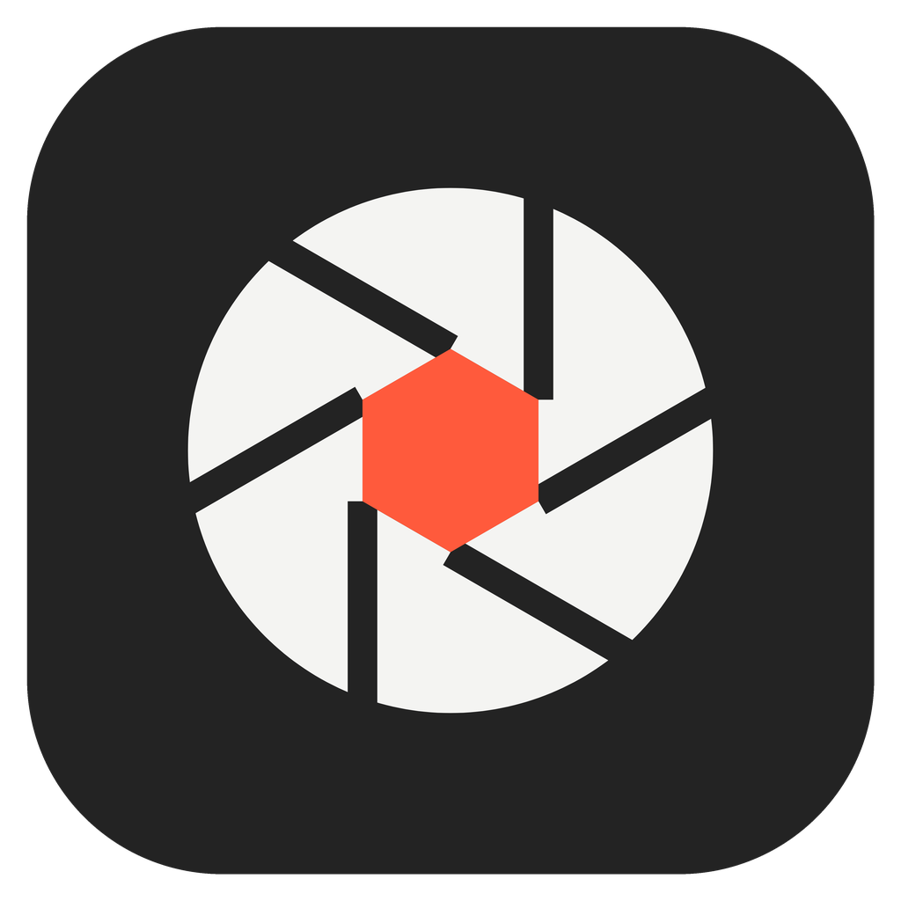

# LumaLink Studio

# Для пользователей из России и Украины, перевод можно найти в [другом руководстве](README-ru.md).


<p align="center"></p>

<p align="center"><a href="https://tryshyzov.github.io/lumacam/">Website and downloads</a></p>

Windows desktop prototype for using an Android phone as a camera. The iOS companion and production installer are not implemented yet. (Pure vibecoding.) 

## Run the desktop app

Requires Python 3.10+ and the packages in `requirements.txt` (the interface uses PySide6, the Qt for Python bindings):

```powershell
python -m pip install -r requirements.txt
python main.py
```

Run the model tests with:

```powershell
python -m unittest discover -s tests -v
```

## Build a Windows executable

On Windows, install PyInstaller and build a standalone windowed executable:

```powershell
python -m pip install -r requirements.txt pyinstaller
.\scripts\fetch-platform-tools.ps1
python -m PyInstaller --noconfirm --clean LumaLinkStudio.spec
```

The executable is written to `dist\LumaLinkStudio.exe`. The fetch script downloads ADB, which the executable bundles for the VPN fallback (see [`vendor/README.md`](./vendor/README.md)).

Every push and pull request is also built by GitHub Actions ([`.github/workflows/build.yml`](./.github/workflows/build.yml)): it runs the tests and uploads the desktop executable, the installer, and the APK as artifacts. The Windows binaries are unsigned until a signing step is added.

### Releases

Pushing a tag such as `v0.2.0` builds everything with that version and publishes a GitHub release with the executable, the installer, and the APK.

The APK is signed with a project key so that a new version installs over the previous one. The key is not in the repository; CI reads it from two repository secrets, `ANDROID_KEYSTORE_BASE64` (the keystore file, Base64-encoded, key alias `lumalink`) and `ANDROID_KEYSTORE_PASSWORD`. Without them, ordinary builds produce a debug APK and a tagged release fails. Keep a backup of the keystore: if it is lost, users must uninstall the app before installing a build signed with a new key.

## Build a Windows installer

Install Inno Setup 6 and build the desktop executable first. From the project root, run:

```powershell
& "$env:LOCALAPPDATA\Programs\Inno Setup 6\ISCC.exe" installer\LumaLinkStudio.iss
```

The setup package is written to `dist\installer`. Build the virtual camera first (see [`virtualcam/README.md`](./virtualcam/README.md)); the installer bundles and registers it. It asks for administrator rights once, because a camera that every application can see is registered machine-wide. It installs no kernel driver. The current desktop and setup executables are unsigned development artifacts, not public release binaries. See [`installer/README.md`](./installer/README.md) for details.

## Build the macOS app

On macOS 13 or later, with Python 3.10+, install the dependencies and PyInstaller, then run the build script from the project root:

```sh
python3 -m pip install -r requirements.txt pyinstaller
scripts/build-macos.sh
```

It writes `dist/LumaLink Studio.app` and `dist/LumaLinkStudio-<version>-macos-apple-silicon.dmg`, or `-intel.dmg` on an Intel Mac: the app runs on the processor it was built on, and CI builds both. The script downloads ADB into `vendor/platform-tools` first if it is missing; the app carries it, because on a Mac the USB connection usually goes through ADB (most phones' USB tethering has no macOS driver). With Xcode installed, the script also compiles `assets/LumaLinkStudio.icon` (an Icon Composer icon) so the icon follows the macOS light, dark, tinted and clear appearances; without it the app keeps the plain `.icns` icon. The app is signed ad hoc, not with a Developer ID, so on another Mac open it the first time with right-click → **Open**. On first launch macOS asks to let it find devices on local networks; allow it, or the phone cannot connect. The build also carries LumaLink Camera for macOS, a camera extension ([`macvirtualcam/`](./macvirtualcam/)), but macOS installs it only from an app signed by an Apple Developer Program team; until then the virtual camera on macOS goes through OBS Virtual Camera (OBS Studio 30+, started once from OBS).

## Connect the Android camera

The `android-app` module is a native Kotlin/CameraX companion. It previews the camera and streams hardware-encoded H.264 access units to the desktop without an access code. USB uses a length-prefixed binary protocol with per-frame acknowledgement and camera-control messages over the phone's USB-tethering network; Wi-Fi uses the same video/control framing over a TCP connection. USB debugging is needed only for the VPN fallback described below.

Build and install from PowerShell with Android SDK and Java 17 configured:

```powershell
.\gradlew.bat :app:installDebug
```

To install the APK built locally and launch it:

```powershell
adb install -r android-app\build\outputs\apk\debug\app-debug.apk
adb shell am start -n com.lumalink.companion.test/com.lumalink.companion.MainActivity
```

Debug builds, and the APKs CI builds for pull requests, are a separate app, **LumaLink Test** (`com.lumalink.companion.test`), installed next to the released **LumaLink Companion**. They never update themselves; releases do.

1. Keep the phone connected and open **LumaLink Companion**.
2. For **USB**, connect the cable and enable **USB tethering** (USB-модем) in the phone's hotspot settings. Select **USB** in the phone app, tap **Начать трансляцию**, then select USB in LumaLink Studio and click **Подключить камеру**. The desktop broadcasts a discovery probe (UDP 8766) on its network adapters, the phone answers only on its USB-tethering interface, and the desktop opens the stream to the phone on TCP 8765. While tethering is on, Windows may route internet traffic through the phone's mobile data.

   **VPN fallback.** A VPN with a kill switch (for example a full-tunnel WireGuard client) blocks all traffic to the phone, IPv4 and IPv6, on every adapter, so neither tethering nor Wi-Fi can work and the block cannot be bypassed from an application. If the phone is not found within 3 seconds, the desktop falls back to `adb forward`, which reaches the same phone listener over USB and loopback and is not affected by the VPN. This path needs **USB debugging** enabled on the phone; `adb.exe` is bundled with the desktop app (see [`vendor/README.md`](./vendor/README.md)). Wi-Fi mode has no such fallback. When the desktop detects such a block, it says so in the connection hint and suggests adding LumaLink Studio to the VPN's split-tunnelling exceptions.
3. For **Wi-Fi**, select Wi-Fi in LumaLink Studio and click **Подключить камеру** so it starts listening. Then select **Wi-Fi** in the phone app and tap **Начать трансляцию**: the phone broadcasts a discovery probe (UDP 8767), LumaLink Studio answers, and the phone connects to it on TCP 8765. If the computer is not found, type the IP shown in LumaLink Studio into the phone app. Both devices must be on the same trusted network; Windows Firewall may ask to allow the desktop app on private networks.
4. Stop the stream from either app when finished. There is no access code or encryption: any device that can reach the desktop on port 8765 can view the camera stream. Use Wi-Fi only on a trusted private network and stop streaming when not needed.

The desktop preview and live Android camera stream use length-prefixed H.264 access units over USB tethering or Wi-Fi. Android encodes with MediaCodec; Windows decodes with PyAV and corrects the stream's 180-degree orientation before displaying or forwarding frames. Each access unit is acknowledged before the next is sent, and the transport keeps only the latest pending access unit to limit queue latency. The desktop can request 480p, 720p, or 1080p analysis output and change focus/auto-focus, exposure, ISO, white balance, front/rear camera, zoom, and target FPS. The Android app applies supported controls via Camera2 and clamps unsupported settings to the device's reported capability ranges; actual stream resolution and cadence can be lower than requested on devices with limited camera modes or processing performance.

### Windows virtual camera

LumaLink Studio ships its own virtual camera, **LumaLink Camera**. It is a user-mode DirectShow filter (source in [`virtualcam/`](./virtualcam/)), not a kernel driver, so it needs no driver signing, test-signing or Secure Boot changes. The installer registers it; after that it appears in the camera list of Zoom, Discord, Telegram, browsers and OBS on Windows 10 and 11, and nothing else has to be installed.

While no video is being sent, the camera shows an idle image, a camera glyph on gray: LumaLink Studio sends it when it runs without a phone, and the filter draws the same image by itself when LumaLink Studio is closed. Compatibility must still be checked in the actual target application; some clients only enumerate cameras when they start.

Zero latency is not possible: camera exposure, encoding, transport, decoding, and desktop display each add delay.

## Product architecture

```text
Android companion (Kotlin / Camera2, CameraX) ─── session + video/control channel
                                                                    │
Planned iOS companion (Swift / AVFoundation) ──────────────────────┘
                                                                   ▼
                                              Windows desktop app (Python prototype)
                                                ├─ preview and settings UI
                                                ├─ USB / Wi-Fi transport adapters
                                                └─ LumaLink Camera (DirectShow)
                                                     │
                         Discord · Telegram · OBS · Zoom · Google Meet
```

LumaLink Camera is installed by the LumaLink Studio installer; no kernel driver is involved.

### Desktop (Windows first)

- The current prototype keeps the desktop UI, connection, decoding, and frame delivery in one Python application; a separate native session service is future work.
- Send frames to LumaLink Camera. When it is not installed (running from source or from the standalone executable), fall back to the `pyvirtualcam` OBS backend and then Unity Capture. Never fall back to a physical camera.
- LumaLink does not install, register, update, or remove third-party camera devices.

### Mobile companions

- Android: implemented in Kotlin with CameraX/Camera2 controls. Device capabilities vary; this prototype does not yet report a complete capability map to the desktop UI.
- iOS: not implemented. A future Swift/AVFoundation companion must query each device/format's supported focus, exposure, white balance, lens, zoom, and frame-rate ranges before displaying controls.
- Both clients negotiate only capabilities actually supported by the selected camera. Unsupported controls remain unavailable rather than reporting false success.

### Transport

- The current prototype sends H.264 video without authentication or encryption over the local network for Wi-Fi. For USB, the desktop discovers the phone on the USB-tethering network and connects to its TCP listener; both transports use length-prefixed H.264 access units, per-frame acknowledgements, and a control channel. The phone accepts USB-mode clients only from the subnet of its tethering interface (`rndis*`, `usb*`, `ncm*`) or from loopback (the `adb forward` fallback), but that link is still unauthenticated and unencrypted.
- LumaLink Camera is a DirectShow filter derived from Unity Capture. OBS Virtual Camera and Unity Capture are only fallbacks for running without the installer.
- A production transport can use an authenticated WebRTC session for video and control messages. Keep transport selection separate from encoding and the camera-control protocol.
- Validate latency, reconnect behavior, and network permissions independently on Android and iOS. Do not assume USB camera mode or USB tethering is available on every phone/OS combination.

### Compatibility and limitations

- The virtual camera exists only after the installer has registered it; preview alone does not register a system-wide camera device. Microsoft Store applications and the Windows Camera app do not list DirectShow cameras.
- Camera controls and available lenses depend on the phone, selected lens, camera format, and OS APIs. In particular, an app must not promise manual ISO, focus, or white balance when the device does not expose them.
- Compatibility should be verified against each target application and Windows version; some video clients enumerate cameras only at startup.

## Implementation milestones

1. Windows desktop shell, shared session/control models, and capability-aware UI.
2. Android companion with hardware H.264 encoding and freshness-bounded USB/Wi-Fi framing over USB tethering or the local network.
3. Windows virtual-camera output through the bundled LumaLink Camera.
4. USB transport polish and Wi-Fi latency/reconnect validation.
5. iOS companion, capability mapping, and USB/Wi-Fi interoperability.
6. Installer/signing, compatibility testing, and end-to-end device matrix.

## License

LumaLink is released under the [Apache License 2.0](./LICENSE). Third-party components and their licenses are listed in [`NOTICE`](./NOTICE).
